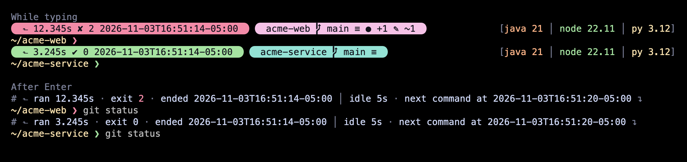

# The `elreydetodo` Oh My Posh theme

`elreydetodo` is a two-line zsh prompt for [Oh My Posh](https://ohmyposh.dev). The first line
reports how the previous command went and the state of git, with tool versions on the right. The
second line is the path and the place to type. When Enter is pressed, both lines are rewritten
into plain text that copies cleanly out of scrollback.



The theme comes in 35 variants. [SCREENSHOTS.md](SCREENSHOTS.md) shows every one of them.

## Requirements

- **Oh My Posh.** `brew install oh-my-posh`
- **A Meslo Nerd Font.** `brew install --cask font-meslo-lg-nerd-font`. The live prompt uses Nerd
  Font icons and rounded pill ends, and other fonts draw them as empty boxes or misalign them. Set
  the terminal's font to `MesloLGSDZ Nerd Font Mono` or another member of the family.
- **iTerm2's "Draw Powerline Glyphs"**, under Profiles, Text. It SHOULD be on. iTerm2 then draws the
  pill ends to fill their character cells exactly, so they line up with the colored bars beside
  them.

## Usage

`.zshrc` loads one variant:

```zsh
eval "$(oh-my-posh init zsh --config ${basedir}/oh-my-posh/elreydetodo-round-gaps-pastel.yml)"
```

To switch variants, change the file name on that line and open a new terminal tab.

To try a variant without editing anything, run the same command in an existing tab, with the full
path. Starting a nested `zsh` first does not work.

```zsh
eval "$(oh-my-posh init zsh --config ~/src/shell-scripts/oh-my-posh/elreydetodo-round-nogaps-mocha.yml)"
```

## Variants

A variant is named `elreydetodo-<edge>-<gaps>-<color>`. The variants differ only in how the
information line is drawn. The input line and the committed prompt are the same in every variant,
apart from their colors.

| Shape | Look |
| --- | --- |
| `round-gaps` | Separate pills with rounded ends and a gap between them. |
| `round-nogaps` | One continuous bar with rounded ends outside. Segments butt together and differ only in color. |
| `angle-gaps` | Separate chips with angular ends and a gap between them. |
| `angle-nogaps` | Angular powerline arrows between segments, as in `agnoster` and `powerlevel10k`. |
| `none-gaps` | No backgrounds. Colored text, with a dim `│` before git. |

There is no `none-nogaps`. With no backgrounds, there is nothing to join.

| Color | Look |
| --- | --- |
| `pastel` | Light pastel backgrounds with near-black text, after the stock `chips` theme. |
| `dark` | Deep shades of the pastels with light text. |
| `mocha` | The softer Catppuccin Mocha accents, as in `catppuccin_mocha`. |
| `rosepine` | The dusty, muted pastels of Rosé Pine Moon. Success is its cyan Foam, because Rosé Pine has no green. |
| `nord` | The cool, low-saturation Frost and Aurora colors of Nord. |
| `tokyonight` | The saturated blues and violets of Tokyo Night. |
| `gruvbox` | The warm, earthy bright accents of Gruvbox dark. |

The colors are ordered from the closest to the plain pastels to the furthest from them. Each set
from `mocha` on takes its pill text from its own theme's background color.

Every combination of a shape and a color exists as a variant file.

## More documentation

- [SCREENSHOTS.md](SCREENSHOTS.md) shows every variant and explains how to regenerate the
  screenshots after a change.
- [DESIGN.md](DESIGN.md) describes what the prompt shows and why, the segments, how the colors and
  files fit together, and what was left out.
- [AGENTS.md](AGENTS.md) holds notes for an agent changing the theme: the owner's preferences, how
  to test without disturbing a live shell, and facts about Oh My Posh learned along the way.
