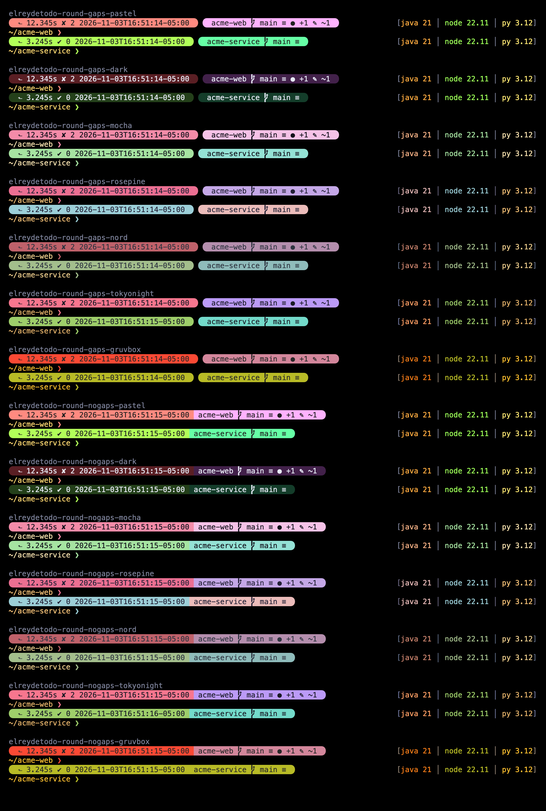
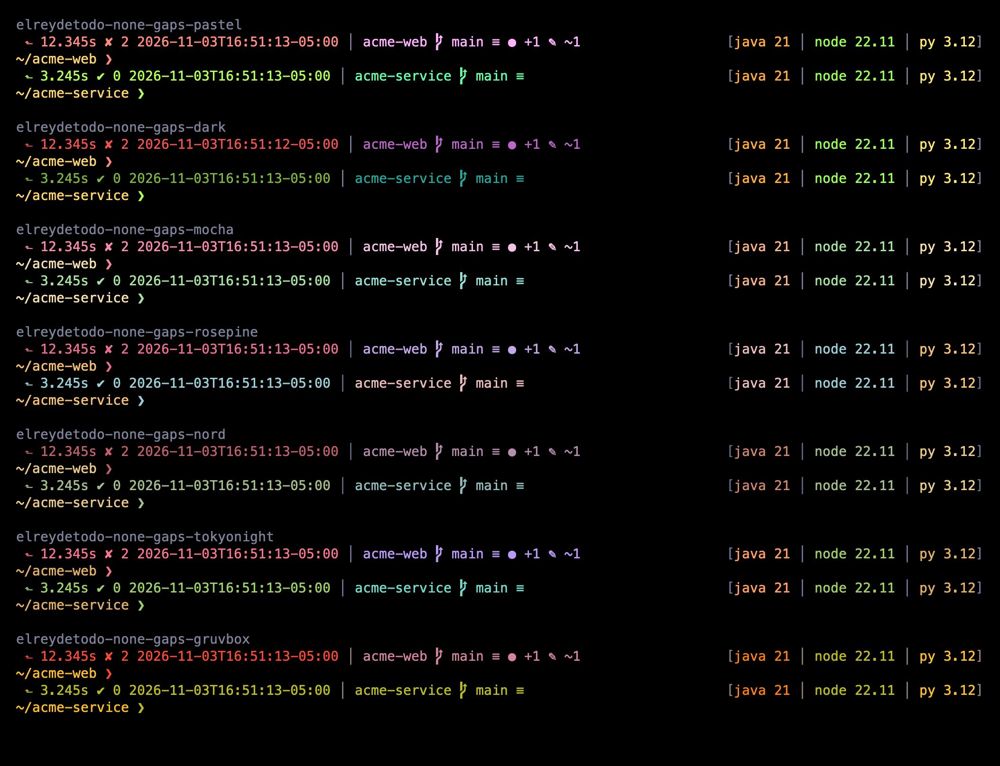
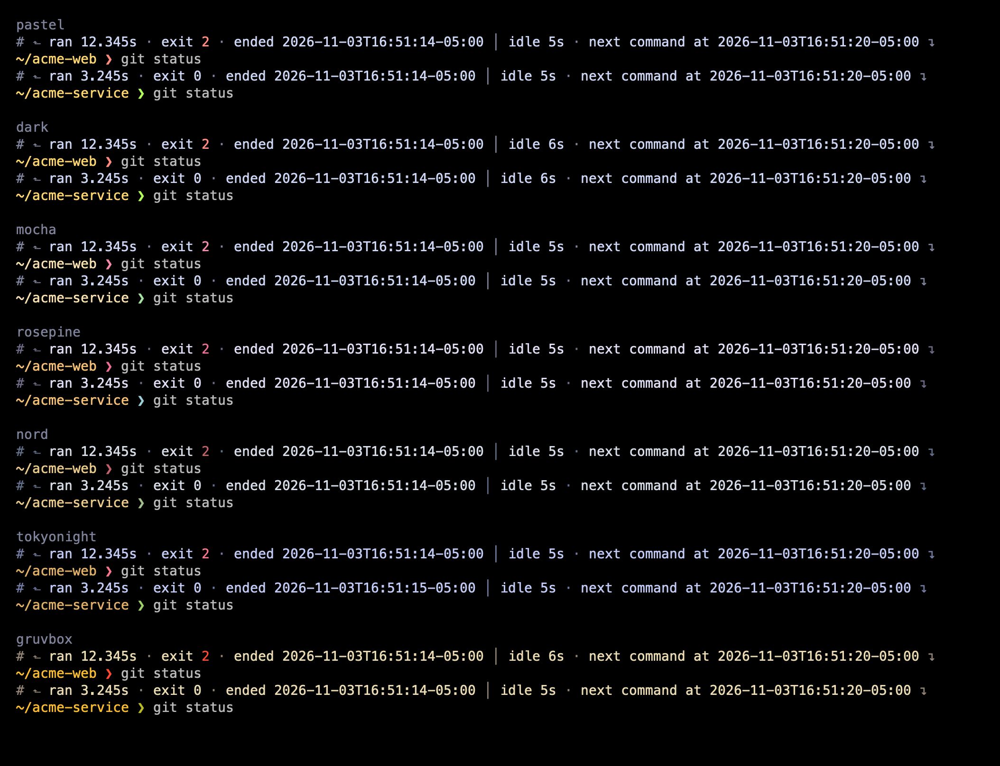

# Screenshots of the `elreydetodo` variants

The screenshots below show each variant twice. The first two lines are the live prompt after a
command failed, in a repository with staged and unstaged changes. The next two are the live prompt
after a command succeeded, in a clean repository. [README.md](README.md) explains the variant
names.

## Rounded edges



## Angular edges


## No backgrounds



## Committed prompts

The committed prompt is the same for every shape of one color. Each color is shown after the
failure and the success, with `git status` typed as the next command.



## Regenerating the screenshots

The screenshots SHOULD be regenerated whenever a variant, a shape, or a color set changes. The
script can be run from any folder:

```zsh
~/src/shell-scripts/oh-my-posh/screenshots/render-screenshots.zsh
```

It writes five images into `screenshots` in about 20 seconds: the four above and the overview in
the README. It needs `oh-my-posh`, `git`, `swiftc` from the Xcode Command Line Tools, and the font.
It does not touch the running shell, its configuration, or Oh My Posh's real cache.

- The script builds two demo repositories and stand-in `java`, `node`, and `python` commands in a
  new temporary folder. The screenshots therefore never show this machine's own files or tools.
- It renders every variant's live prompt with `oh-my-posh print primary`, waits four seconds, and
  renders each color's committed prompt with `oh-my-posh print transient`. The idle times and
  timestamps in the images are real.
- `screenshots/ansi-to-png.swift` draws the captured escape codes on a grid of character cells, as
  a terminal does. Each background fills its whole cell, and the Powerline shapes are drawn to fill
  their cells exactly, as iTerm2 does with "Draw Powerline Glyphs" on.
- The README's overview shows the variant named by `overview` near the top of the script.
- The font, size, and colors match the iTerm2 profile in use when the screenshots were made:
  `MesloLGSDZNFM-Regular` at 14 points, `#BBBBBB` text on `#000000`. The environment variables
  `ELREYDETODO_FONT`, `ELREYDETODO_FONT_SIZE`, `ELREYDETODO_FOREGROUND`, and
  `ELREYDETODO_BACKGROUND` override them.
- The temporary folder is left in place for inspection, and the script prints its path. macOS
  clears old files from the temporary folder on its own.
